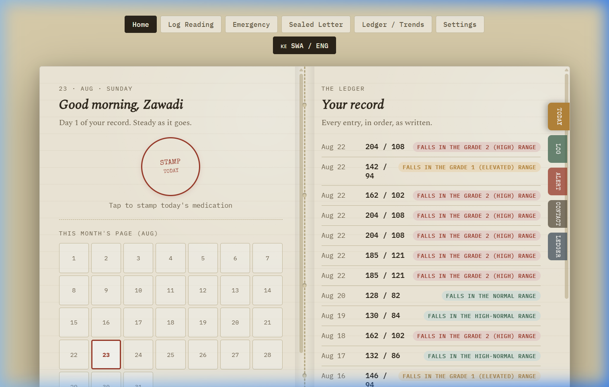
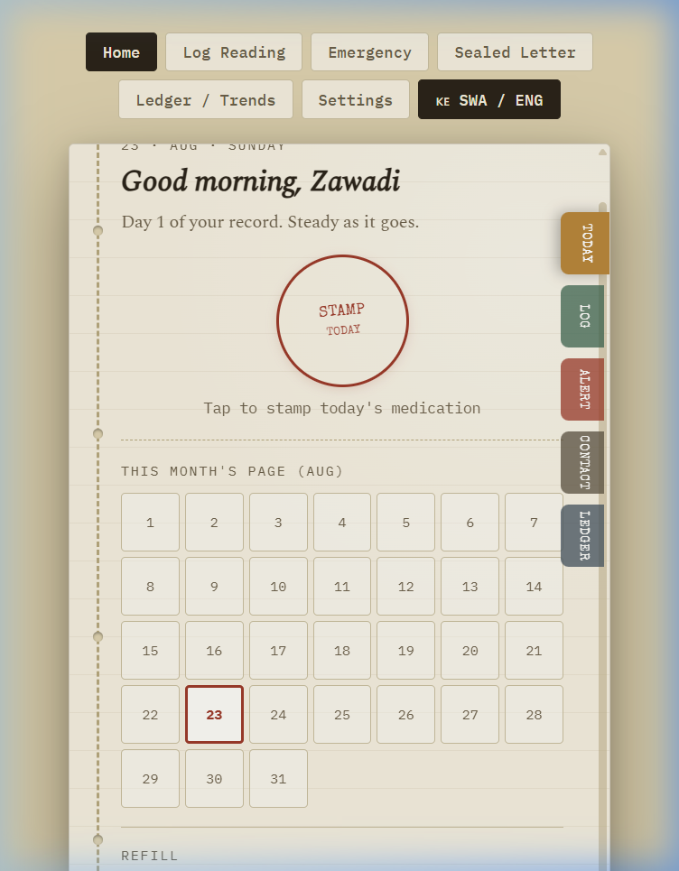
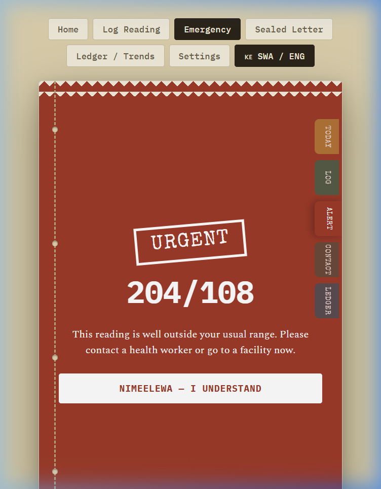
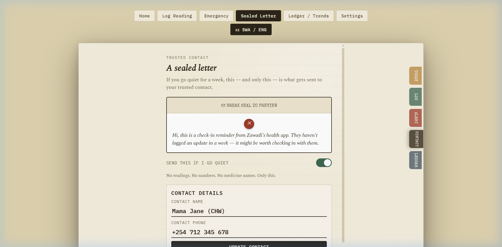

# TunzaCare (Mwendelezo wa Afya)

> **Tunza** (*Swahili: to nurture, care for, look after*) + **Care** (*English*)  
> A clinically grounded, privacy-preserving care continuity companion for adults in Kenya managing hypertension and/or type 2 diabetes post-diagnosis.

[](#automated-testing)
[](LICENSE)
[](src/i18n/)
[](docs/DECISIONS.md)

---

> [!CAUTION]
> ### Clinical & Safety Disclaimer
> **TunzaCare is a self-management and care continuity companion, not a diagnostic medical device.**  
> It does not provide medical diagnoses, prescribe medications, or modify dosages. All clinical cutoffs, emergency triggers, and educational prompts are cited directly from established international and national guidelines (International Society of Hypertension 2020 Global Practice Guidelines, American Diabetes Association 2024 Standards of Care, and Kenya MoH NCD Guidelines). In any acute crisis, TunzaCare directs patients immediately to physical emergency care at the nearest hospital or dispensary.

---



---

## The Problem: The Post-Diagnosis Retention Drop-Off

In Kenya, an estimated **24.5% of adults live with hypertension**, yet **fewer than 1 in 50 (3%) achieve blood pressure control**.

The breakdown rarely occurs at initial screening. It occurs in the silent months following diagnosis:
1. **Asymptomatic False Security**: Hypertension and diabetes are largely "silent." Patients often feel completely healthy while blood pressure or blood sugar climbs to dangerous thresholds, leading to discontinued medication.
2. **Prescription Stockouts & Friction**: In rural and peri-urban transport contexts, chemist trips require advance planning. Running out of medication triggers silent drop-out.
3. **Loss to Follow-up**: When patients miss consecutive check-ins, traditional systems fail to notice until a severe cardiovascular crisis (stroke, myocardial infarction, DKA) brings them to an emergency room.

**TunzaCare** bridges the vulnerable gap between clinic visits with low-friction daily tracking, proactive silent-dropout escalation, and emergency guidance.

---

## Core Product Features & Screenshots

### 1. The Daily Passport Stamp & Visa-Grid Streak
Built on a tactile **Ledger & Passport metaphor**, patients log daily adherence with a single tap of the rubber-stamp button. The visual visa-grid calendar renders confirmed check-in days, transforming chronic disease management into a tangible record of continuity.



### 2. Live Band Classification & Dual-Output Vitals Logging
When a patient logs blood pressure or blood sugar, the system provides immediate, non-shaming visual classification based on **ISH 2020 Home Monitoring Bands** and **ADA 2024 Fasting Glucose Cutoffs**.


### 3. Non-Dismissible Emergency Alerts
If a reading crosses critical safety thresholds ($\ge 200/100\text{ mmHg}$, $\text{SBP} < 80\text{ mmHg}$, $\le 53\text{ mg/dL}$, or $> 400\text{ mg/dL}$), the interface immediately triggers a high-contrast **Torn Paper Emergency Interrupt**. The alert cannot be dismissed by clicking away, pressing Escape, or navigating back—it requires an explicit, conscious acknowledgment tap (*"Nimeelewa — I understand"*).



### 4. Zero-Health-Data Escalation Subsystem
When a patient fails to check in for 5 consecutive days, the app triggers a gentle self-prompt. After 7 days of silence, it can notify a trusted family member or Community Health Promoter (CHP).

To guarantee strict patient privacy, the escalation trigger is **opt-in only (strictly OFF by default)** and sends **ZERO health data**—no blood pressure numbers, no glucose readings, no medication names, and no adherence percentages.



---

## Architectural & Governance Invariants

All development follows eight non-negotiable rules (decision trail in [`docs/DECISIONS.md`](docs/DECISIONS.md)):

| Rule | Invariant & Implementation |
| :--- | :--- |
| **Rule 1: Clinical Fidelity** | Zero invented numbers. Every cutoff traces directly to `src/data/clinical_thresholds.json`. |
| **Rule 2: Vitals Immutability** | Historical health records are append-only (`readings` log). Corrections create a new timestamped entry linked to `originalReadingId`. |
| **Rule 3: Emergency Safety** | Emergency alerts cannot be suppressed, softened, or auto-dismissed without explicit acknowledgment. |
| **Rule 4: Privacy Chokepoint** | `/src/escalation/` is the sole outbound directory. Outbound triggers transmit exclusively the patient's chosen display name and generic check-in text. |
| **Rule 5: Local-First Storage** | 100% operational offline without continuous cloud dependency via on-device storage. |
| **Rule 6: 1:1 Bilingual Symmetry** | Bidirectional key parity between English ([`src/i18n/en.json`](src/i18n/en.json)) and Swahili ([`src/i18n/sw.json`](src/i18n/sw.json)). |
| **Rule 7: Non-Shaming Tone** | Copy audit enforces supportive, empowering language without shame or stigma. |
| **Rule 8: Multi-Tier Responsive** | Adapts from a single-page pocket book on mobile (360–430px) to an open two-page notebook spread ($\ge 700\text{px}$). |

---

## Project Structure

```
TunzaCare/
├── 04_TODO.md                     # Open work items
├── 05_DESIGN_MOCKUP.html          # Design mockup
├── 09_DESIGN_LEDGER_CONCEPT.html  # Ledger & Passport design concept
├── 13–15_LOGO_*.svg               # Logo assets
├── LICENSE                        # MIT License
├── package.json                   # Project metadata & npm test configuration
├── server.js                      # Zero-dependency local dev server
├── docs/
│   ├── DECISIONS.md               # Architectural & design decision audit trail
│   ├── SESSION_SUMMARY.md         # Full build session record
│   └── screenshots/               # Production screenshots
├── src/
│   ├── data/clinical_thresholds.json  # Single source of truth for all clinical numbers
│   ├── escalation/escalation.js   # Isolated outbound escalation subsystem
│   ├── i18n/                      # English & Swahili dictionaries + translation engine
│   ├── logic/                     # Adherence, education, readings & classification
│   ├── storage/store.js           # Local-first persistence with memory fallback
│   └── ui/                        # App shell, reactive bindings, styles
└── tests/                         # 23 clinical-boundary, invariant, privacy & i18n tests
```

---

## Quickstart & Local Setup

TunzaCare is built with zero runtime framework dependencies (vanilla JavaScript ES modules, CSS, and HTML), ensuring lightning-fast performance on budget smartphones.

### Prerequisites
- Node.js (v18.0.0 or higher)

### 1. Clone & Run Dev Server
```bash
# Clone the repository
git clone https://github.com/Tolbert-Okoth/TunzaCare.git
cd TunzaCare

# Start local server
node server.js
```
Open your browser and navigate to `http://127.0.0.1:8085/`.

### 2. Run Automated Test Suite
```bash
# Run all 23 unit, boundary, invariant, and bilingual tests
npm test
# or directly:
node --test tests/*.test.js
```

---

## Automated Testing & Validation

The test suite covers every clinical boundary and architectural safety invariant:

```
TAP version 13
ok 1 - Adversarial: Extreme Physiological Reading Values
ok 2 - Adversarial: Same-day duplicate check-in updates rather than corrupting log
ok 3 - Adversarial: Zero or depleted prescription supply behavior
ok 4 - Adversarial: Unit conversions bidirectional precision
ok 5 - Boundary Clinical (Rule 8): 80% Adherence Threshold
ok 6 - Boundary Clinical: Blood Pressure Display Bands (ISH Home Monitoring)
ok 7 - Boundary Clinical: Blood Pressure Emergency Thresholds (>=200/100 or SBP <80)
ok 8 - Boundary Clinical (USER ITEM 1): Glucose Nudge vs Emergency Boundaries
ok 9 - Core Logic: Reading log is immutable and appends records
ok 10 - Core Logic: getAlertLevel returns dual outputs (displayBand AND isEmergency)
ok 11 - Core Logic: calculateAdherenceRate evaluates check-in proxy vs 80% cutoff
ok 12 - Core Logic: getRefillStatus evaluates max(7 days, 20% of supply)
ok 13 - Core Logic: checkEscalationTrigger 5-day self-prompt and 7-day contact notify
ok 14 - Emergency Invariant (Rule 3): Emergency Alerts Cannot Be Softened or Auto-Dismissed
ok 15 - Escalation Invariant (USER ITEM 2): Fresh profile defaults strictly to disabled
ok 16 - Escalation Privacy (Rule 4): Composed message contains ONLY display name and zero health data
ok 17 - Escalation Invariant: Disabled escalation returns ESCALATION_DISABLED and sends nothing
ok 18 - Escalation Invariant (USER ITEM 3): Offline queue-and-retry handles dropped connection
ok 19 - Escalation Adversarial: Late check-in cancels pending escalation trigger
ok 20 - Escalation Adversarial: Mid-cycle disable stops pending contact notification
ok 21 - i18n (Rule 6): Bidirectional 1:1 key parity between English and Swahili
ok 22 - i18n: Lookup and interpolation work accurately
ok 23 - i18n (USER ITEM 4 / Rule 7): Non-shaming copy audit across all strings
1..23
# tests 23
# pass 23
# fail 0
```

---

## License

This project is licensed under the [MIT License](LICENSE).

Built by **Tolbert Okoth**: [GitHub](https://github.com/Tolbert-Okoth) · [LinkedIn](https://www.linkedin.com/in/tolbert-asumba-542b3b344)
